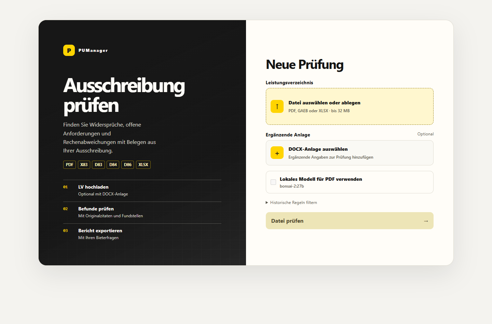
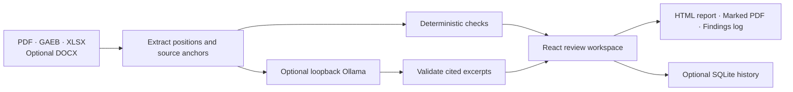

# PUManager

**Find tender risks before they become bid costs.**

PUManager is a local review workspace for German bills of quantities (*Leistungsverzeichnisse*, or LVs). An estimator uploads an LV, reviews findings against the original sources, edits a German clarification question (*Bieterfrage*), and exports a report. Each finding shows where to look and why it matters for the bid.

Built for **Challenge A — AI-Powered Cost Estimation and BoQ Analysis**, TUM.AI Construction Hackathon.



[Run locally](#run-locally) · [90-second judge walkthrough](#90-second-judge-walkthrough) · [Try more examples](#try-more-examples) · [Verification](#verification)

## Run locally

Install Git and **uv**. uv provisions Python 3.12 and installs the locked dependencies. The React bundle is included, so you only need Node.js to rebuild the frontend. [Install uv](https://docs.astral.sh/uv/getting-started/installation/)

```sh
git clone https://github.com/CrashPine/TUM.AI-Construction-Hackathon.git
cd TUM.AI-Construction-Hackathon
uv sync --locked
uv run --locked python -m boqcheck.web
```

Open **[http://127.0.0.1:8000](http://127.0.0.1:8000/)** and keep the terminal open. This route runs the deterministic checks and exports without an Ollama installation. If port 8000 is occupied, append `--port 8001` and open that port. On Windows, `.start-bidguard.ps1 -RulesOnly` also starts the rules-only app.

### Enable local AI

Start Ollama and use `ollama list` to get the exact name of an **installed local chat model**. The team verified `bonsai-2:27b`. The model weights are separate from this repository. [Ollama for Windows](https://docs.ollama.com/windows)

```sh
uv run --locked python -m boqcheck.web --endpoint http://127.0.0.1:11434/api/chat --model "bonsai-2:27b" --max-requests 1 --timeout 240
```

Replace the model name and port if your installation differs. On Windows, `.start-bidguard.ps1` checks the model and tries port 44445 before 11434. `-OllamaPort` and `-Model` override those settings. Stop the previous server with Ctrl+C before reusing its port.

For each PDF, enable **Lokales Modell für PDF verwenden**. Choose **Stichprobe (schnell)** for a bounded run or **Alle Textabschnitte** to send all extracted text windows plus selected cross-window pairs. Long documents can take much longer. The report shows actual coverage and any model failure, and the rule-based findings remain available.

## 90-second judge walkthrough

Use **[`LV_09_Porenbetondach.pdf`](data/raw/LV_09_Porenbetondach.pdf)** from `data/raw`. This real four-page roof LV gives a reproducible finding even if Ollama is unavailable.

| Time | What to do | What to look for |
| --- | --- | --- |
| 0–15 s | Select the roof PDF and click **Datei prüfen**. Leave the DOCX field empty. | **Klärungsbedarf** on the drawing scope. |
| 15–35 s | Open the source link **PDF-Seite 1**. | Two yellow highlights and comments. OZ **9.2.3** refers to facade drawings and OZ **9.2.4** describes roof panels. |
| 35–55 s | Return to the finding, select **Bestätigt**, edit **Bieterfrage**, and click **Änderungen speichern**. | An editable question grounded in the two excerpts. |
| 55–70 s | Open **Risikobericht** and choose **HTML herunterladen** or **Drucken / Als PDF speichern**. | The downloaded report contains the saved question. **Befundprotokoll** and **Annotiertes PDF** are separate exports. |
| 70–90 s | Switch to the prepared Ollama result described below. | A second example with the model’s contribution and coverage visible. |

**Suggested Bieterfrage**

> Sind Zeichnungen für die Dachplatten, die Fassade oder beide Bauteile einzukalkulieren?

**Prepare the AI segment before recording.** Upload **[`LV-Schachtbauwerk.pdf`](data/raw/LV-Schachtbauwerk.pdf)**, enable Ollama, select **Stichprobe (schnell)**, and run the review. The built-in rule selects the 8 mm and 15 mm clauses on PDF pages **2 and 5**. When the model flags the same evidence, the report displays **Modellbefund an denselben Quellen**. The team verified this result with local Ollama. Use the completed report during a recording, since inference speed and responses can vary. [Detailed demo and acceptance walkthrough](docs/estimator-demo.md)

## What PUManager checks

| Capability | Evidence shown to the estimator |
| --- | --- |
| Requirements and scope | Page and position anchors for incompatible specifications, unresolved scope, and selected cross-document differences. |
| Quantities and totals | Source cells or paragraphs for invalid positions, duplicates and arithmetic findings. Supported checks include unit-price bases, selected subtotal layouts, and comparable units. |
| Review and export | Confirm, dismiss or leave a finding open. Preserve revised Bieterfragen in a self-contained HTML report and browser printout. |
| Local model review | Ollama compares selected source excerpts and proposes findings. PUManager validates both quoted passages and reports what was covered. |
| Learning from past reviews | Confirmed findings can be promoted to SQLite for replay on later LVs. A separately configured dataset supports historical quantity and price comparisons. |

### Try more examples

| File or workflow | Expected result |
| --- | --- |
| `HEM2301-2_Gesamt-LV.pdf` | Two rule-based diameter discrepancies (**DN 125 / DN 100**) on file pages **96** and **104**. Use rules-only for a fast check on this 136-page LV. |
| `GAEB-[PROJEKT_004].X83` | 50 positions. An unpriced request does not produce a missing-price error. |
| `Angebot AN24-0305.D84` | 274 checked position totals. Try **Was-wäre-wenn-Rechnung** to compare a hypothetical quantity or price with the source. |
| XLSX | Create a sheet with headings `OZ`, `Kurztext`, `Menge`, `ME`, `EP`, `Preisbasis`, `Gesamtbetrag`. Add one row with `01.01.0010` stored as text, `Dachplatte`, `10`, `m2`, `2`, `1`, `19.99`. The expected total is 20.00 and the finding cites row 2. Use values in numeric cells. |
| DOCX attachment | Add `LV-Positionen.docx` in the attachment field to inspect paragraph references. Automatic comparison needs matching position and component context. |

## How it works



Python handles extraction, validation and exports. React provides the upload and review controls. The model connection is local by default, and the optional online spelling lookup is disabled by default. Standard review links are tied to the running server. Download the HTML, PDF and log before restarting. Reviewer edits are reflected in HTML, while the annotated PDF and log capture the original review run.

## Verification

```sh
uv run --locked pytest -q
uv run --locked ruff check src tests
```

The default suite covers the included fixtures, source anchors, arithmetic, and upload-to-export scenarios. Real-model tests are opt-in. [CLI, model tests and historical datasets](docs/advanced-review.md)

**Known limits.** Findings are candidates for estimator review. Coverage counts describe the text sent to the model and completed requests. They do not establish exhaustive detection. A full-text scan still selects cross-window pairs rather than reviewing every possible pair. Scanned pages without text are skipped. PDF arithmetic depends on recognized layouts, and GAEB 90 price checks have documented assumptions. Historical anomaly tests include labelled synthetic data, and benchmarking across independent projects remains open. [Delivery status and open items](docs/hackathon-checklist.md)

## Develop

```sh
npm --prefix frontend ci
npm --prefix frontend run build
```

| Path | Contents |
| --- | --- |
| `frontend/` | React and CSS sources |
| `src/boqcheck/` | Importers, checks, web server and exports |
| `data/raw/` | Included tender samples |
| `tests/` | Parser, regression and acceptance tests |

[Data inventory](data/README.md) · [Review architecture](docs/pdf-contradiction-review.md) · [Hackathon implementation prompt](BidGuard-AI-hackathon-prompt)
